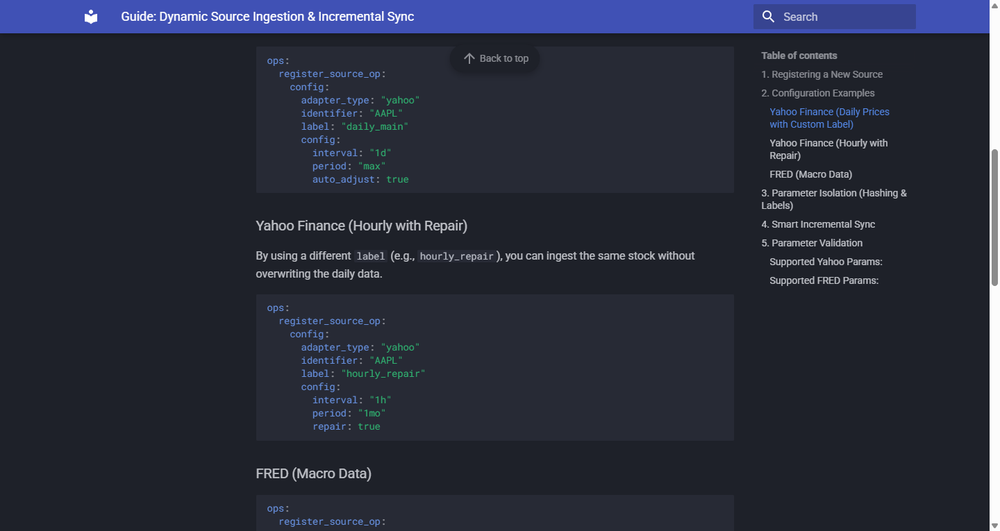
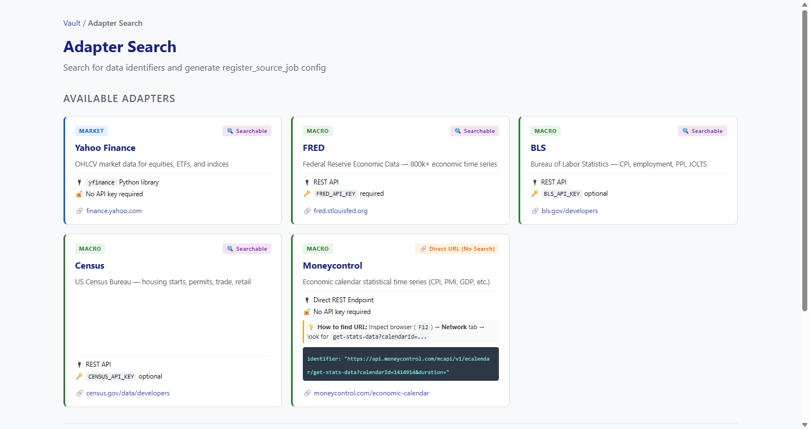
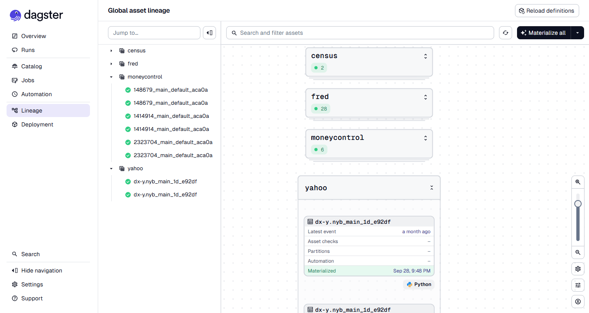
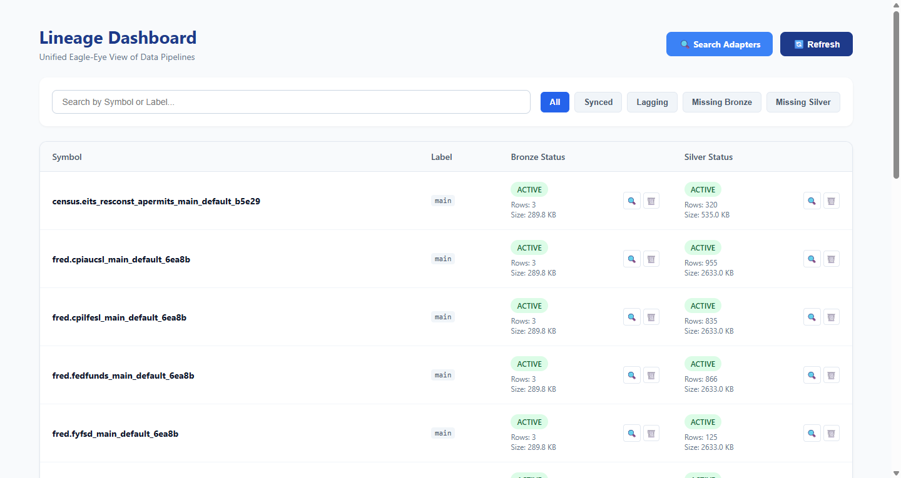
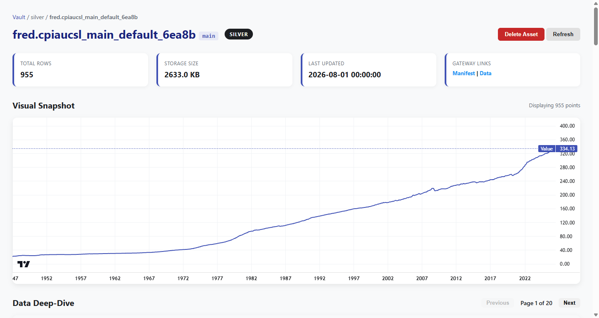
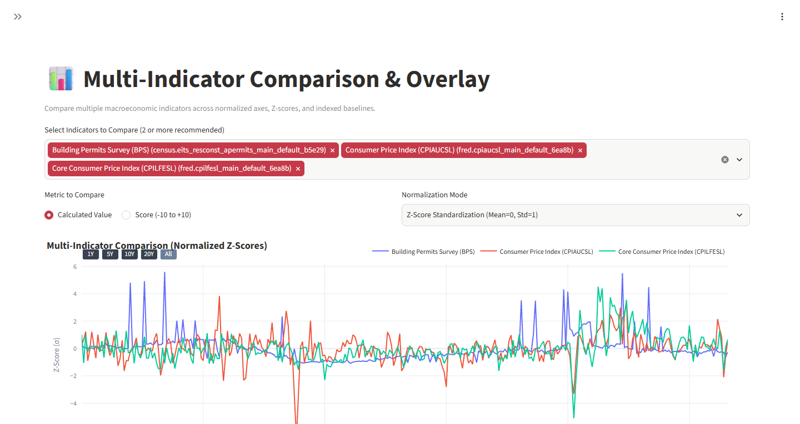

# The Terminal

### A Public Engineering Showcase of a Macroeconomic Data Infrastructure & Quantitative Research Platform

[](#repository-status)
[](#public-release-notice)
[](https://www.python.org/)
[](https://www.docker.com/)

The Terminal is a modular engineering platform designed to support macroeconomic data infrastructure, financial data processing, quantitative research, and reproducible analytical workflows.

It brings together data engineering, workflow orchestration, analytical storage, and quantitative research within a structured architecture.

This repository showcases selected architectural decisions, engineering practices, system components, and implementation examples from the original project.

---

## Public Release Notice

**This repository is a sanitized public snapshot derived from the original private project.**

It has been prepared specifically for portfolio presentation, technical demonstration, and documentation purposes.

Important distinctions:

- This is not the original development repository.
- It is a separate public edition derived from the original implementation.
- Sensitive configurations, credentials, private infrastructure details, proprietary datasets, and selected internal implementation details have been excluded.
- The original private project remains the primary and authoritative implementation.
- Active development, maintenance, and future improvements will continue exclusively in the original private project.
- This public repository is not intended to receive ongoing development, feature updates, or maintenance.

The public edition represents selected aspects of the original engineering work and should not be considered a complete or independently maintained distribution of the original system.

---

## Project Overview

The original system is organized around two complementary projects:

### 1. The Terminal — Data Infrastructure

The core infrastructure responsible for managing the financial and macroeconomic data lifecycle.

Key capabilities include:

- Structured data ingestion from external sources.
- Immutable raw data storage.
- Domain-specific data validation and normalization.
- Analytical data storage.
- Workflow orchestration.
- Data lineage and traceability.
- Infrastructure observability.

### 2. The Terminal Research — Quantitative Research

A complementary research environment designed for financial experimentation and quantitative analysis.

Key capabilities include:

- Reusable financial indicators and mathematical functions.
- Modular research experiments.
- Structured experiment execution.
- Reproducible research runs.
- Experiment metadata and version tracking.
- Quantitative result storage.
- Research visualization and comparison.

The separation between infrastructure and research allows data processing and analytical experimentation to evolve independently.

Together, these projects form a modular foundation for systematic macroeconomic and quantitative research.

---

## System Architecture

The architecture follows a modular, layered approach, separating data infrastructure from research computation and presentation.

### Data Infrastructure

The data lifecycle is organized into three conceptual layers:

| Layer | Responsibility |
|---|---|
| Bronze | Immutable raw data ingestion and preservation |
| Silver | Validation, normalization, and domain-specific schemas |
| Gold | Analytical datasets and point-in-time features |

**Bronze — Raw Data**

Preserves original API payloads and source data with metadata, timestamps, hashes, and lineage information.

**Silver — Validated Data**

Transforms raw data into structured, domain-specific representations using validation models and explicit schemas.

**Gold — Analytical Data**

Provides analytical datasets and point-in-time accurate features for quantitative research, statistical analysis, and backtesting workflows.

### Quantitative Research Architecture

The research platform separates five primary responsibilities:

1. **Core:** Reusable mathematical functions and financial indicators.
2. **Research:** Experiment definitions, parameters, and execution logic.
3. **Orchestration:** Workflow scheduling and dependency management.
4. **Storage:** Research metadata and analytical outputs.
5. **Visualization:** Dashboards and experiment analysis.

This separation keeps mathematical computation independent of infrastructure and presentation concerns.

---

## Screenshots & System Overview

The following screenshots demonstrate selected components of the platform, from data source registration and orchestration to dataset inspection and quantitative analysis.

### 1. Dynamic Source Ingestion & Incremental Sync


### 2. Data Source Adapter Registry


### 3. Dagster Asset Lineage


### 4. Data Pipeline Lineage Dashboard


### 5. Dataset Inspection & Visualization


### 6. Multi-Indicator Comparison & Overlay


## Technology Stack

The original implementation uses a combination of technologies across different engineering domains.

| Domain | Technologies |
|---|---|
| Programming | Python |
| Workflow Orchestration | Dagster |
| Event Streaming | Redpanda |
| Analytical Storage | ClickHouse |
| Relational Storage | PostgreSQL |
| API Development | FastAPI |
| Data Validation | Pydantic |
| Data Processing | Pandas, Parquet |
| Visualization | Streamlit |
| Containerization | Docker, Docker Compose |
| Observability | Grafana, Prometheus, Loki, OpenTelemetry |

The technologies listed represent the original project's architecture and technology choices. Their presence in this public repository does not necessarily mean every component or integration is included in the public snapshot.

---

## Engineering Principles

The platform is built around several engineering principles.

### 1. Separation of Concerns

Data ingestion, transformation, computation, orchestration, storage, and visualization have distinct responsibilities.

### 2. Reproducibility

Research experiments are structured, parameterized, and designed to support repeatable execution.

### 3. Data Traceability

Data transformations and research executions are designed with lineage and metadata tracking in mind.

### 4. Modular Architecture

Components are designed to evolve independently without tightly coupling the entire system.

### 5. Reusable Computation

Mathematical and analytical functions remain independent of infrastructure and presentation layers.

### 6. Point-in-Time Data Integrity

Historical analytical workflows consider data availability at the relevant point in time, an important requirement for avoiding look-ahead bias in financial research.

---

## Example: Quantitative Research Workflow

A typical research workflow follows this sequence:

```text
External Data Sources
        |
        v
   Data Ingestion
        |
        v
  Data Validation
        |
        v
  Analytical Storage
        |
        v
 Research Experiment
        |
        v
 Indicator Computation
        |
        v
  Research Results
        |
        v
  Visualization
```

Research computation is separated from orchestration and visualization, allowing experiments to remain independently testable and reusable.

---

## Research Design

The quantitative research environment follows an experiment-oriented design rather than relying exclusively on ad-hoc notebooks.

Each research experiment is intended to define:

- Input datasets.
- Experiment parameters.
- Computational logic.
- Execution metadata.
- Output references.
- Reproducibility information.

### Example Research Components

- Technical indicators: RSI, SMA, and volatility.
- Statistical analysis: Correlation and distribution analysis.
- Risk metrics and quantitative features.
- Financial experimentation and comparative analysis.

These examples illustrate the research architecture and the types of computations supported by the original project.

---

## Project Structure

The research platform follows a modular structure:

```text
project/
│
├── core/
│   ├── indicators/
│   │   ├── rsi.py
│   │   ├── volatility.py
│   │   └── sma.py
│   │
│   ├── data/
│   └── utils/
│
├── research/
│   ├── volatility/
│   │   ├── experiment.py
│   │   └── config.py
│   │
│   └── correlation/
│       ├── experiment.py
│       └── config.py
│
├── dagster/
│   ├── assets.py
│   ├── jobs.py
│   └── schedules.py
│
├── registry/
├── storage/
├── apps/
│   ├── api/
│   └── streamlit/
│
├── configs/
└── tests/
```

This structure illustrates the logical organization of the research system. It is a representative architectural view and not necessarily an exact copy of the original private repository.

---

## Screenshots & Technical Demonstrations

This section presents selected visual evidence of the original system's implementation.

The public showcase may include:

- System architecture and component interactions.
- Data pipeline execution and orchestration.
- Infrastructure monitoring and observability.
- Research experiment execution.
- Analytical outputs and visualizations.
- Selected code excerpts demonstrating engineering practices.

Screenshots and code samples are selected and sanitized to avoid exposing private infrastructure, credentials, or sensitive implementation details.

---

## Development Philosophy

The Terminal reflects an engineering approach centered on building reliable infrastructure for systematic economic and quantitative research.

Its development emphasizes:

- Engineering discipline over ad-hoc scripting.
- Reproducible research over isolated experiments.
- Explicit data lineage over opaque transformations.
- Modular systems over tightly coupled applications.
- Reusable computation over duplicated logic.
- Reliable infrastructure over presentation-only prototypes.

The objective is to establish a structured foundation where data engineering and quantitative research operate as complementary but independently evolving domains.

---

## Repository Status

**Status: Archived — Public Snapshot — Not Actively Maintained**

This repository represents a specific public snapshot of the original project.

It is provided as a technical portfolio and engineering reference, not as an actively maintained software distribution.

No ongoing development, feature additions, bug fixes, or synchronization with the original private implementation are planned for this public edition.

The original private project remains the authoritative source of development.

---

## Scope & Disclaimer

This repository is intended to demonstrate software engineering, data architecture, infrastructure design, and quantitative research organization.

It does not expose the complete original implementation, private operational configurations, credentials, proprietary datasets, or confidential research materials.

The architecture and examples presented here are for technical demonstration and educational reference.

Nothing in this repository should be interpreted as financial advice, investment recommendations, or a guarantee of investment performance.

---

**The Terminal**

*Building infrastructure for systematic economic and quantitative research.*
